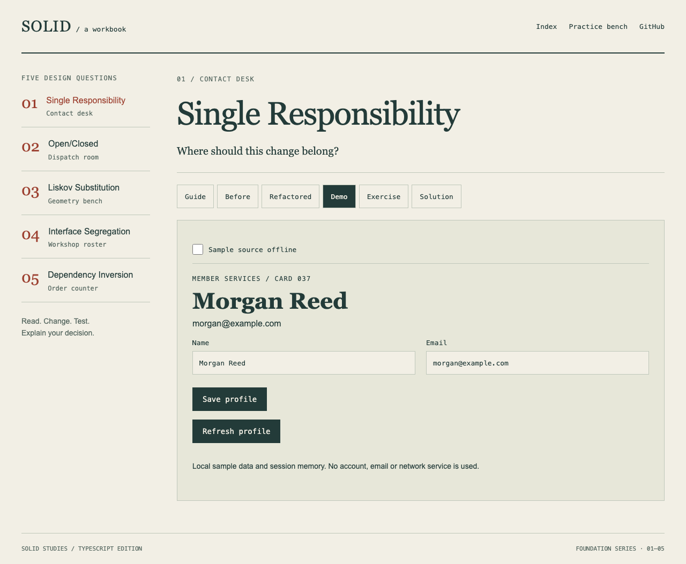
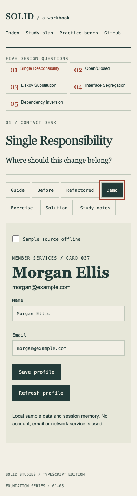
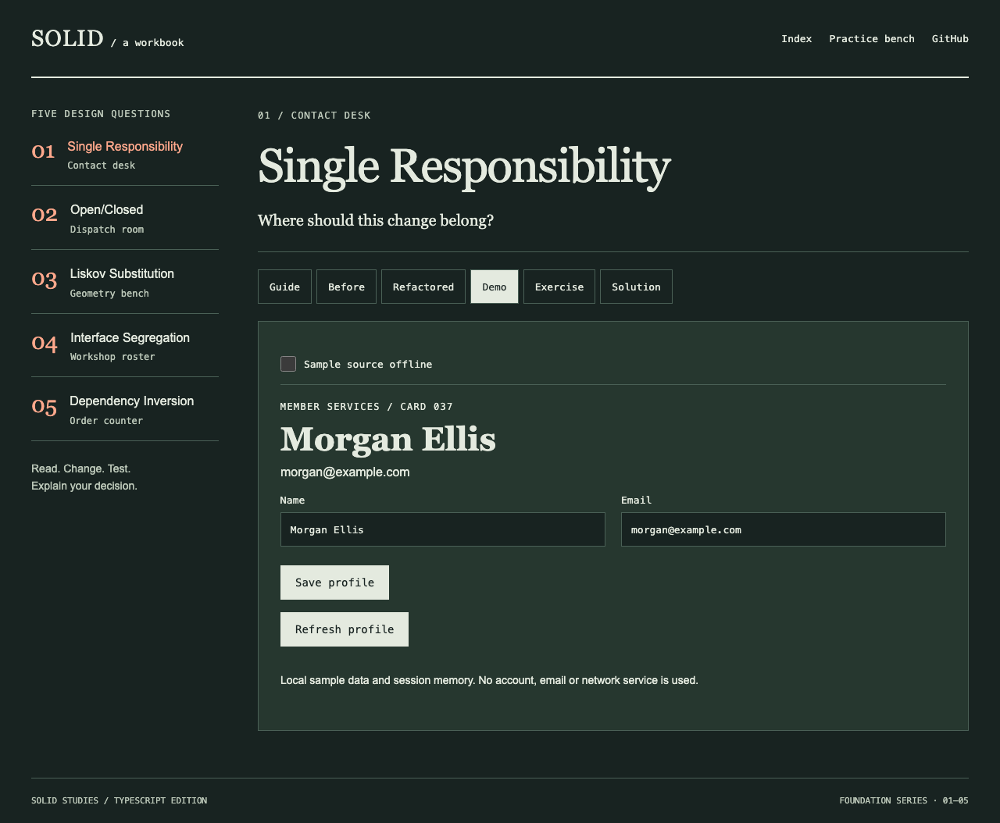
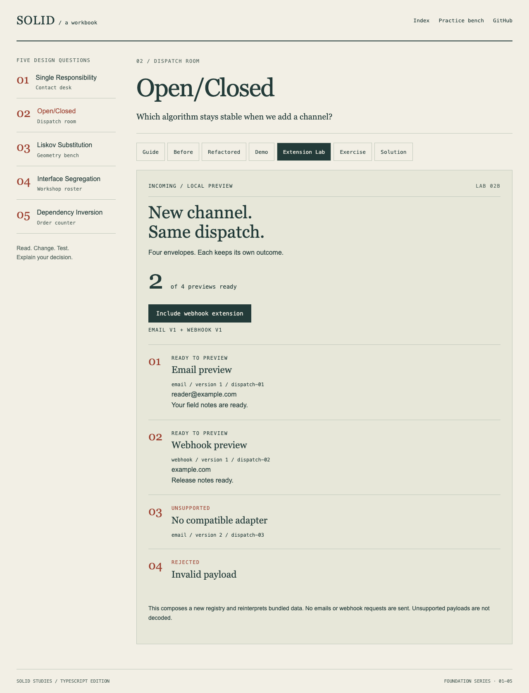
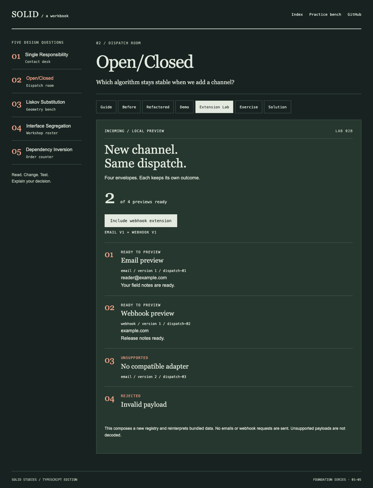

# SOLID principles · TypeScript & React

A workbook for practising five design questions through source, local demonstrations and small changes. Start with a lesson, run its demo, then attempt the exercise before reading a solution.

| Lesson | Setting | Design question |
| --- | --- | --- |
| [01 · Single Responsibility](src/principles/1-single-responsibility/README.md) | Contact desk | Where should this change belong? |
| [02 · Open/Closed](src/principles/2-open-closed/README.md) | Dispatch room | Which algorithm stays stable when we add a channel? |
| [03 · Liskov Substitution](src/principles/3-liskov-substitution/README.md) | Geometry bench | Does the replacement keep the caller’s promise? |
| [04 · Interface Segregation](src/principles/4-interface-segregation/README.md) | Workshop roster | What does this consumer actually need? |
| [05 · Dependency Inversion](src/principles/5-dependency-inversion/README.md) | Order counter | Can the supplier change independently of the policy? |

## Run locally

Use Node.js **22.12 or newer** and npm. CI uses Node 22. The Vite 7 toolchain no longer supports the original README’s Node 16 requirement.

```bash
git clone https://github.com/aguamonkey/solid-principles-typescript.git
cd solid-principles-typescript
npm ci
npm run dev
```

Open the URL printed by Vite. Production assets use `/solid-principles-typescript/`; hash routing keeps direct lesson links working on static hosting. This milestone does not deploy a website.

## Contact desk





Actual Chromium screenshots from production browser tests. The workbook uses ruled paper, serif headings and an indexed navigation rather than generic marketing cards.

## Dispatch room · extension contracts




The Extension Lab previews a bundled batch through exact channel/version registrations. No email or webhook request is sent. Desktop, mobile and dark behaviour is covered by browser tests.

## How to study

Follow the [learning path](docs/LEARNING_PATH.md). SRP now includes a concrete exercise, separate solution, decision record and interview prompts. OCP adds a [versioned dispatch lab](src/principles/2-open-closed/advanced/README.md), separate compatibility exercise/solution and decision/interview notes. LSP/ISP/DIP have connected foundations; their advanced tracks remain future work.

The Before and Refactored sections display actual checked-in source. The Demo section mounts the local implementation. The Practice bench provides recall questions and links to exercises; it does **not** compile or execute arbitrary TypeScript. Use your editor and repository tests for coding exercises.

The examples use different settings from the [Swift series](https://github.com/aguamonkey/SOLID-Principles-with-Swift), while sharing design questions. More interfaces or classes do not automatically make a design better.

## Verification

```bash
npm run check          # Types, enforced lint, docs, unit/component tests, production build
npx playwright install chromium
npm run test:browser   # Production build must already exist
```

The focused suites contain **60 unit/component tests, four documentation-tooling tests and eleven Chromium browser tests**. Browser checks cover all five demos, direct lesson reloads, guided practice, a narrow viewport and dark appearance. SRP tests include validation, runtime decoding, failure retention, obsolete work, unmounting, storage failure and StrictMode cleanup.

CI repeats these checks with Node 22 and uploads browser results on failure. No test claims to prove SOLID compliance in every context. The documentation checker covers local inline links, images and Markdown heading fragments; it does not check external URL availability or reference-style links. See [contributing](CONTRIBUTING.md) for screenshot and review expectations.

## Scope

These are local teaching fixtures. There are no real account, payment, notification or database services. SRP snapshot storage is session memory. The examples and browser tests do not constitute a security review, a full accessibility audit or support for every browser. The intentionally coupled Before examples retain unsafe patterns for comparison; lint exceptions are restricted to those files.

## Licence

[MIT](LICENSE)
