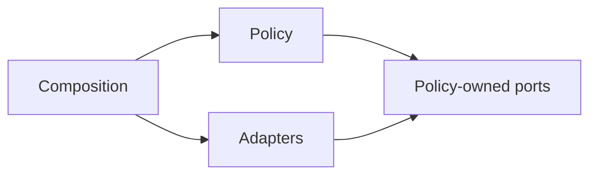

# Order counter · policy-owned supplier boundaries

[Foundation](../README.md) · [Decision](DECISION.md) · [Exercise](EXERCISE.md) · [Interview prompts](INTERVIEW.md)

Open the DIP lesson’s **Boundary Lab**. Record a £32.99 order, then process its pending receipt. Choose email or print previews at composition. The acceptance and processing policies use the same contracts regardless of concrete suppliers.

Change the supplier scenario to reveal separate failure boundaries. Storage can fail before a commit, or commit successfully while losing its acknowledgement. A preview can fail, or return successfully while queue acknowledgement fails. The counters show recorded orders, pending receipts and actual local previews rather than pretending every failed call means no work happened.

## Progression

| Scope | Question | Evidence |
| --- | --- | --- |
| Foundation | Can policy accept storage and notification dependencies? | Constructor injection and actual channel receipts |
| Feature ownership | What does the caller know when one step fails? | Recorded, replayed, conflicting and unconfirmed acceptance; separate processing outcomes |
| System ownership | Who owns supplier contracts and retry guarantees? | Policy-owned ports, atomic local order/outbox records, idempotent acceptance and explicit duplicate-effect evidence |

These are reasoning scopes, not fixed seniority labels.

## Dependency direction

[OrderPolicy.ts](OrderPolicy.ts) imports only [OrderPorts.ts](OrderPorts.ts). [OrderAdapters.ts](OrderAdapters.ts) implements those contracts. [OrderBoundaryLab.tsx](OrderBoundaryLab.tsx) is the composition boundary. A service container or framework is not required to invert the source dependency.

## Acceptance contract

- Input is runtime-checked. Identity is a nonblank string, recipient passes the stated basic email-shape rule, and total is nonnegative safe-integer GBP pence. This is not comprehensive email deliverability validation.
- Accepted input is copied and frozen before crossing the asynchronous recorder boundary.
- `OrderRecorder.record` must commit an order and one pending receipt together. The local adapter installs both in one synchronous map assignment. A production adapter must fulfil this contract with appropriate durable transaction semantics.
- Identity is exact, case-sensitive and not trimmed. Repeating the same identity, recipient and amount returns replayed, without another order or pending receipt. Changed content returns conflict and preserves the original.
- A recorder exception yields **unconfirmed**. It cannot prove whether storage committed. Retrying the same identity/content can reconcile a lost acknowledgement.
- Acceptance does not call a sender. A recorded order may still have a pending receipt.

## Processing contract

`ReceiptQueue` supplies the next pending item and records acknowledgement. `ReceiptSender` returns a supplier receipt. Processing snapshots the pending values, awaits the supplier, then acknowledges the queue. No pending item means no supplier call.

| Outcome | What the caller knows |
| --- | --- |
| empty | Queue returned no pending item |
| queue-unconfirmed | Queue could not be read; supplier was not called |
| send-unconfirmed | Supplier threw; queue acknowledgement was not attempted, but an effect may already have occurred |
| ack-unconfirmed | Supplier returned a receipt; queue acknowledgement did not confirm |
| acknowledged | Supplier returned and queue acknowledgement resolved |

The supplied previews are local strings and a local log. **No email, print job, payment or database request is made.** The queue tracks acknowledgement, not independently verified delivery to a person.

## Retry limits

Order acceptance is idempotent for the stated identity/content. Receipt effects are not exactly once. A supplier can perform an effect then throw, or acknowledgement can fail after the effect. A retry may repeat that effect. The tests demonstrate both uncertainty and duplication rather than hiding them.

There is no claim/lease, multi-worker exclusion, durable queue, retry backoff, dead-letter queue or provider idempotency key enforcement. Concurrent processing calls can read the same pending item and produce two previews; a test records this limitation. The UI disables controls during an operation, but that is not a distributed lock. State is session memory and disappears when this lab unmounts.

Ports are trusted typed contracts, not a sandbox. Tests establish sampled behaviours and import direction is visible in source; DIP alone cannot supply transactionality, security or delivery guarantees.

Read the [tests](Order.test.tsx), then attempt the [deduplicating preview exercise](EXERCISE.md) before its [solution notes](SOLUTION.md).
